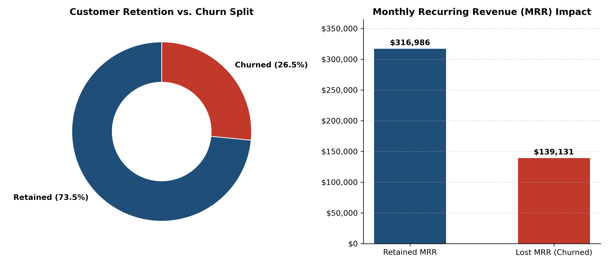
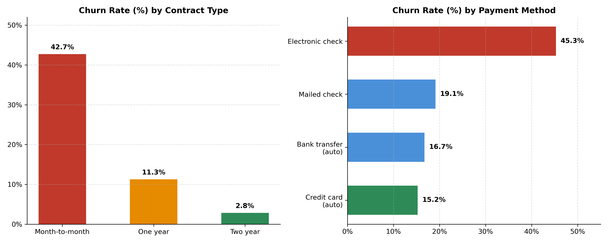
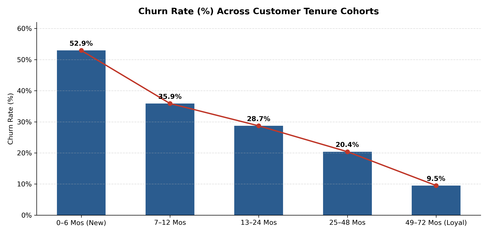
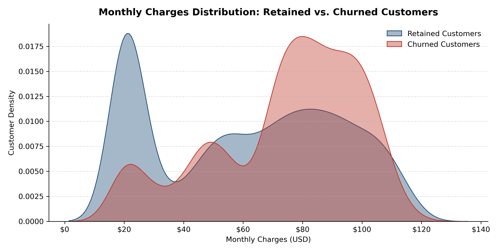

# Customer Retention & Churn Analysis (`FUTURE_DS_02`)

**Track:** Data Science & Analytics — Task 2 (Future Interns)  
**Author:** Casebar Mkhari | BSc Applied Mathematics & Statistics (UNISA)  
**Tools Used:** Python (`Pandas`, `NumPy`, `Matplotlib`, `Seaborn`, `Statsmodels`), Jupyter Notebook  

---

## 1. Executive Summary & Business Problem
In subscription-based businesses, customer churn directly erodes Monthly Recurring Revenue (MRR) and customer lifetime value. This project analyzes **7,043 customer accounts** from the Telco Customer Churn dataset to identify why subscribers leave, quantify revenue at risk, evaluate tenure cohort survival patterns, and recommend high-ROI retention interventions.

### Core Retention & Churn KPIs
| Metric | Value |
| :--- | :--- |
| **Total Customer Base** | **7,043** |
| **Retained Customers** | **5,174 (73.46%)** |
| **Churned Customers** | **1,869 (26.54%)** |
| **Total Monthly Recurring Revenue (MRR)** | **$456,116.60** |
| **Monthly Revenue Lost to Churn** | **$139,130.85 (30.5% of MRR)** |
| **Annualized Revenue at Risk** | **$1,669,570.20** |
| **Average Tenure (Retained vs. Churned)** | **37.6 months vs. 18.0 months** |
| **Average Customer Lifetime Value (CLV)** | **$2,279.73** |



---

## 2. Key Analytical Findings

### A. Contract Structure & Billing Friction Drive Churn
* **Month-to-Month Vulnerability:** Customers on month-to-month contracts churn at **42.71%** (1,655 of 3,875 accounts), accounting for **$120,847.10/month**—or **86.9%** of all lost monthly revenue—compared to just **11.27%** on one-year contracts and **2.83%** on two-year contracts.
* **Payment Method Friction:** Subscribers paying manually via **Electronic Check** exhibit a **45.29%** churn rate, nearly triple the churn rate of customers enrolled in automatic billing (**15.24%** for automatic credit card; **16.71%** for automatic bank transfer).



### B. Early-Lifecycle Drop-Off Across Tenure Cohorts
* Churn is heavily front-loaded during customer onboarding: **52.94%** of subscribers in the **0–6 month cohort** cancel, dropping to **35.89%** in months 7–12 and **28.71%** in months 13–24.
* Once customers pass the 4-year mark (**49–72 months**), churn stabilizes at **9.51%** while average monthly spend rises to **$73.95**.



### C. High-Tier Service Churn & Pricing Sensitivity
* **Fiber Optic Dissatisfaction:** Despite being a premium tier, **Fiber Optic** subscribers churn at **41.89%** (compared to **18.96%** for DSL and **7.40%** for phone-only subscribers), clustering heavily in the `$70–$110/month` billing bracket.



### D. Statistical Churn Drivers (Logistic Regression Odds Ratios)
A multivariable Logistic Regression model ($p \le 0.0001$ across all predictors) quantifies the independent effect of each factor on the odds of churning:
* **Two-Year Contract (`OR = 0.1946`):** Reduces the odds of churn by **80.5%** compared to month-to-month contracts.
* **One-Year Contract (`OR = 0.4324`):** Reduces the odds of churn by **56.8%** compared to month-to-month contracts.
* **Tech Support Enrollment (`OR = 0.6543`):** Reduces churn odds by **34.6%**, demonstrating strong retention value from proactive technical onboarding.
* **Electronic Check Payment (`OR = 1.6517`):** Increases churn odds by **65.2%** holding all other variables constant.
* **Fiber Optic Internet (`OR = 1.6326`):** Increases churn odds by **63.3%**, signaling competitive pricing pressure or service quality issues in the fiber tier.

---

## 3. Actionable Retention Recommendations
1. **Launch a Month-to-Month to Annual Contract Migration Campaign:** Target high-spend month-to-month subscribers (`$120.8K/month` revenue at risk) with a 1-month free discount or loyalty perk for switching to a 1-year agreement, cutting churn odds by over 56%.
2. **Incentivize Auto-Pay Migration from Electronic Check:** Offer a one-time `$10–$15` bill credit for Electronic Check customers (45.29% churn) who enroll in automatic credit card or bank transfer billing (~15–17% churn).
3. **Introduce a Structured 90-Day Onboarding & Tech Support Bundle:** Because over half (52.94%) of 0–6 month subscribers churn and Tech Support reduces churn odds by 34.6%, bundle complimentary Tech Support for the first 6 months on all new Fiber Optic activations.
4. **Audit Fiber Optic Pricing & Network Reliability:** Conduct a competitive rate and service-quality review for Fiber Optic plans in the `$75–$105/month` range where churn density peaks.

---

## 4. Repository Structure
```text
FUTURE_DS_02/
├── data/
│   └── telco_customer_churn_cleaned.csv    # Cleaned dataset with engineered tenure cohorts
├── visuals/
│   ├── 01_churn_overview_mrr_impact.png
│   ├── 02_churn_by_contract_and_payment.png
│   ├── 03_tenure_cohort_churn_curve.png
│   └── 04_monthly_charges_distribution.png
├── customer_churn_analysis.ipynb           # Python EDA, logistic regression & visual generation
└── README.md                               # Executive report & retention strategy
